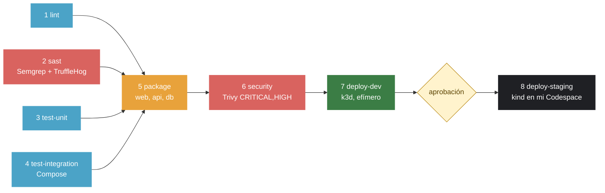

# Perfil: Jair Alegria Medina

Sitio personal publicado en https://jair2412.github.io

## Cómo se publica
Cada push a `main` despliega automáticamente con GitHub Pages.

## Flujo de trabajo
- `main` protegida; todo cambio entra por pull request
- Una rama por cambio: `feature/*`, `fix/*`
- Mensajes de commit en imperativo, ≤ 50 caracteres

## Historial del curso
- **S02**: Sitio inicial, ramas y pull requests
- **S03**: LAB-02, contenedorización con Docker (api + db + web), Codespaces y GHCR
- **S06**: LAB-04, pipeline end-to-end (CI/CD con DEV y STAGING)

## LAB-04: Pipeline end-to-end

La aplicación es el libro de visitas de [demo-cicd](https://github.com/urp-topicos-2026-2/demo-cicd), con tres servicios (`web`, `api` y `db`). La traje a este repositorio sobre la rama del LAB-03. Mi perfil sigue publicándose en GitHub Pages con su propio workflow (`pages.yml`), aparte del pipeline.

### El pipeline

| Etapa | Herramienta | Qué revisa | Si falla | Corre en |
|---|---|---|---|---|
| 1. lint | ESLint, HTMLHint, Hadolint | Estilo y errores del JavaScript, el HTML y los tres Dockerfile | No se publica ninguna imagen | PR y push a `main` |
| 2. sast | Semgrep (`p/ci`, `p/dockerfile`) y TruffleHog | Patrones inseguros en el código, el workflow y los Dockerfile; secretos en todo el historial de Git | No se publica ninguna imagen | PR y push a `main` |
| 3. test-unit | Vitest + Supertest, jsdom | La API con un pool falso, sin base de datos, y el HTML de la página | No se publica ninguna imagen | PR y push a `main` |
| 4. test-integration | Docker Compose + Vitest (`fetch`) | La aplicación completa entrando por `web`, como un usuario | No se publica ninguna imagen | PR y push a `main` |
| 5. package | Docker Buildx, GHCR | Construye y publica `demo-cicd-{web,api,db}:sha-<commit>` | Nada llega a escanearse | PR y push a `main` |
| 6. security | Trivy | Vulnerabilidades `CRITICAL` y `HIGH` con parche en cada imagen. Las aceptadas van en `.trivyignore`, y hoy está vacío | Nada llega a DEV | PR y push a `main` |
| 7. deploy-dev | k3d, kubectl + Kustomize | Un clúster efímero dentro del runner: rollout, smoke y las mismas pruebas de integración | Nada llega a STAGING | Solo push a `main` |
| 8. deploy-staging | Runner self-hosted, kind | La **misma** imagen que pasó por DEV, en un STAGING persistente, después de mi aprobación | STAGING se queda con la versión anterior | Solo push a `main`, con aprobación |

Cada run deja un resumen con las pruebas (total, pasaron, fallaron), las vulnerabilidades de cada imagen por severidad, las imágenes que se promueven y el estado de los pods de STAGING. Lo escribe [`scripts/resumen.mjs`](scripts/resumen.mjs). Así, quien aprueba STAGING sabe qué está aprobando sin abrir ningún log.

`main` está protegida con un ruleset: exige PR, y que pasen `lint`, `sast`, `test-unit`, `test-integration`, los tres `package` y los tres `security`. Dependabot revisa las acciones, npm y las imágenes base cada semana, con `cooldown` de 7 días.

### STAGING en mi Codespace

En mi máquina Docker no funciona, así que STAGING vive en un Codespace en lugar de Rancher Desktop:

- Un clúster **kind** llamado `staging` publica el NodePort 30080, igual que Rancher Desktop.
- El **runner self-hosted** `codespace-staging` corre en el mismo Codespace.
- El Secret `db-credenciales` lo creé a mano en el clúster, y el pipeline nunca lo toca.
- [`scripts/staging-codespace.sh`](scripts/staging-codespace.sh) crea el clúster y, cada vez que el Codespace arranca, vuelve a prender el clúster y el runner.

La limitación: si el Codespace está apagado, el runner aparece *Offline* y `deploy-staging` queda en cola hasta que lo prendo.

### B3: Rompiendo el pipeline por etapa

| Etapa | Qué rompí | Run en rojo | Run en verde | Se detectó en el minuto |
|---|---|---|---|:-:|
| lint | `FROM node` sin tag en `api/Dockerfile` (Hadolint DL3006) | [run](https://github.com/jair2412/jair2412.github.io/actions/runs/41036244740) | [run](https://github.com/jair2412/jair2412.github.io/actions/runs/41036684196) | 0:16 |
| sast | Quité el `cooldown` de Dependabot (Semgrep) | [run](https://github.com/jair2412/jair2412.github.io/actions/runs/41036251346) | [run](https://github.com/jair2412/jair2412.github.io/actions/runs/41036735317) | 0:21 |
| test-unit | `200` en vez de `400` cuando falta el nombre | [run](https://github.com/jair2412/jair2412.github.io/actions/runs/41036257542) | [run](https://github.com/jair2412/jair2412.github.io/actions/runs/41036785599) | 0:32 |
| test-integration | nginx apuntando a `api:3001` | [run](https://github.com/jair2412/jair2412.github.io/actions/runs/41036265490) | [run](https://github.com/jair2412/jair2412.github.io/actions/runs/41036837488) | 1:05 |

Lo barato se detecta temprano. Un Dockerfile mal escrito se ve a los 16 s, y una mala configuración de nginx al minuto. Si esa misma falla de nginx hubiera llegado a STAGING, la habría encontrado una persona usando la página.

### B6: Pipeline más rápido

Tiempos sacados de la pestaña Actions, sin contar la espera de la aprobación. El "antes" es mi primer run completo en verde.

| Job | Antes ([run](https://github.com/jair2412/jair2412.github.io/actions/runs/41034310112)) | Después ([run](https://github.com/jair2412/jair2412.github.io/actions/runs/41049652319)) |
|---|:-:|:-:|
| 1. lint | 16 s | 12 s |
| 2. sast | 19 s | 23 s |
| 3. test-unit | 11 s | 15 s |
| 4. test-integration | 30 s | 40 s |
| 5. package (el más lento de los tres) | 74 s | 26 s |
| 6. security (el más lento de los tres) | 21 s | 29 s |
| 7. deploy-dev | 80 s | 69 s |
| 8. deploy-staging | 39 s | 27 s |
| **Total**, del inicio del run al final de DEV, más la duración de STAGING | **4 min 45 s** | **3 min 23 s** |

De 285 s a 203 s: **29 % menos**. Algunos jobs sueltos tardan unos segundos más (la duración varía de un run a otro según el runner), pero ya no se suman uno detrás de otro: hasta `package` solo cuenta el más lento de los cuatro, no la suma.

Qué cambié:

- **Paralelismo sin saltarme compuertas.** `test-unit` ya no espera a `lint`, ni `test-integration` a `test-unit`. Las cuatro revisiones corren a la vez y `package` espera a las cuatro.
- **Solo amd64.** Quité QEMU y `linux/arm64`. El runner de GitHub y mi Codespace son amd64, y emular arm64 era lo más lento del build: `package` de `api` pasó de 74 s a 23 s.
- **k3d en lugar de kind** para DEV. Crear el clúster pasó de 41 s a 17 s.
- **`concurrency`.** Un commit nuevo en un PR cancela el run anterior, que ya no sirve.
- **`proxy_connect_timeout 2s` en nginx** ([PR #30](https://github.com/jair2412/jair2412.github.io/pull/30)). Después de cada despliegue, el smoke de STAGING esperaba 63 s por el POST: ver la bitácora.

La caché de capas de Docker (`type=gha`) ya funcionaba: los builds sin cambios bajan a segundos. Trivy guarda su base de datos con la caché de la acción.

### Bitácora de decisiones

#### B1: Trivy en `CRITICAL,HIGH` con honestidad

- **Decisión:** corregí las 37 `HIGH` en lugar de aceptarlas:
  - `web`: `apk upgrade`.
  - `api`: `body-parser` 1.20.9, y borré npm, npx, corepack y yarn de la imagen final, porque la API solo necesita `node` para correr y el npm de la imagen base traía 10 `HIGH` en sus propias dependencias.
  - `db`: cambié el `gosu` compilado con Go 1.24.6 (26 `HIGH` de la librería estándar) por `su-exec` de Alpine, que hace lo mismo y está escrito en C.
- **Alternativas que evalué:**
  - Aceptar las 26 de `gosu` una por una en `.trivyignore`. Es válido y documentado, pero la vulnerabilidad sigue en la imagen.
  - Correr Postgres directamente como usuario `postgres`, sin `gosu`. Rompe los permisos del volumen en Kubernetes.
- **Por qué elegí esta:** lo que no está en la imagen no se puede explotar, y `.trivyignore` queda vacío.
- **Fuentes consultadas:** [docker-entrypoint.sh de Postgres](https://github.com/docker-library/postgres/blob/master/docker-entrypoint.sh), [su-exec](https://github.com/ncopa/su-exec), [Trivy: filtrado](https://trivy.dev/latest/docs/configuration/filtering/)
- **Cómo lo verifiqué:** [run en verde con `CRITICAL,HIGH`](https://github.com/jair2412/jair2412.github.io/actions/runs/41030960050), [run en rojo antes del arreglo](https://github.com/jair2412/jair2412.github.io/actions/runs/41029200651)
- **Qué no me funcionó:**
  - Primero sobrescribí `gosu` con un symlink y después con una copia de `su-exec`, y Trivy lo seguía reportando: analiza capa por capa y solo deja de ver un archivo de la imagen base si hay un borrado real. Lo resolví borrando `/usr/local/bin/gosu` y poniendo el nuevo en `/usr/local/sbin`, que va antes en el `PATH`.
  - `ln -s` falló porque `/usr/local/sbin` no existía en la imagen.

#### B2: TruffleHog en lugar de Gitleaks, y k3d en lugar de kind

- **Decisión:**
  - Secretos: TruffleHog 3.99.7 en contenedor, con `--fail`.
  - DEV: k3d v5.9.0, el binario con versión fija.
- **Alternativas que evalué:**
  - *Secretos*: GitHub Secret Scanning (gratis en públicos, pero no frena el pipeline: avisa después del push) y detect-secrets (necesita un archivo *baseline* y mantenerlo).
  - *DEV*: minikube (más pesado, pensado para una máquina y no para un runner efímero) y quedarme con kind.
  - *Escaneo de imagen*: Grype en lugar de Trivy. Lo descarté porque Trivy en `CRITICAL,HIGH` es la regla del B1.
- **Por qué elegí esta:**
  - TruffleHog intenta **verificar** cada hallazgo contra el servicio real, y eso dice si el secreto sigue vivo. Con `--results=verified,unknown,unverified` también frena los no verificados, porque un token que hoy no responde igual no debe estar en Git.
  - k3d corre k3s, el Kubernetes liviano de Rancher, el mismo que usa Rancher Desktop, y crea el clúster en menos de la mitad del tiempo.
- **Fuentes consultadas:** [TruffleHog](https://github.com/trufflesecurity/trufflehog), [k3d](https://k3d.io/), [kind](https://kind.sigs.k8s.io/)
- **Cómo lo verifiqué:**
  - Runs en verde: el [PR #26](https://github.com/jair2412/jair2412.github.io/actions/runs/41036585933) y [`main`](https://github.com/jair2412/jair2412.github.io/actions/runs/41045349476).
  - En rojo a propósito: [TruffleHog encontró un token de GitHub falso](https://github.com/jair2412/jair2412.github.io/actions/runs/41037584395), y [k3d no completó el rollout con el probe en `/api/salud`](https://github.com/jair2412/jair2412.github.io/actions/runs/41039480747).
- **Qué no me funcionó:** el token falso estaba en una rama aparte, pero el job `sast` hace checkout con `fetch-depth: 0`, que trae el historial de **todas** las ramas. El [run de `main` del PR #21](https://github.com/jair2412/jair2412.github.io/actions/runs/41038881319) se puso en rojo en Gitleaks por ese token. Aprendí que una prueba con un secreto falso se borra apenas termina: cerré el PR, borré la rama y el job volvió a verde.

#### STAGING en un Codespace

- **Decisión:** runner self-hosted y clúster kind dentro de un Codespace, porque Docker no funciona en mi máquina.
- **Alternativas que evalué:**
  - Rancher Desktop en mi laptop: es lo que pide la guía, pero no tengo Docker local.
  - Un clúster en la nube (GKE, Oracle Cloud): necesita credenciales y es el Reto 5.
- **Por qué elegí esta:** el Codespace ya tenía Docker y kubectl, y es Linux amd64 igual que DEV. El job sigue siendo `runs-on: self-hosted` con aprobación, y STAGING es persistente mientras el Codespace existe.
- **Fuentes consultadas:** [Self-hosted runners](https://docs.github.com/en/actions/hosting-your-own-runners), [kind: extraPortMappings](https://kind.sigs.k8s.io/docs/user/configuration/#extra-port-mappings)
- **Cómo lo verifiqué:** [primer run de `main` aprobado y desplegado a STAGING](https://github.com/jair2412/jair2412.github.io/actions/runs/41034310112)
- **Qué no me funcionó:** desde `gh codespace ssh`, `git push` no tiene credenciales: el ayudante de credenciales del Codespace solo funciona dentro de VS Code.

#### Peticiones colgadas en STAGING después de cada despliegue

- **Decisión:** `proxy_connect_timeout 2s` en `web/nginx.conf` ([PR #30](https://github.com/jair2412/jair2412.github.io/pull/30)), y reintentos cortos ante `5xx` en el smoke test.
- **Alternativas que evalué:**
  - Solo reintentar en el smoke: esconde el problema y un usuario lo seguiría viendo.
  - `kubectl rollout restart deploy/api` después de cada despliegue: suma tiempo y no arregla la causa.
  - Un `preStop` con `sleep` en el Deployment de `api`, para que el pod siga vivo unos segundos mientras sale del Service. También funciona, pero toca los manifiestos de la plantilla y alarga cada rollout.
- **Por qué elegí esta:** nginx espera por defecto **60 s** para conectarse a un upstream. Justo después de un rollout, el Service de `api` todavía puede mandar una conexión nueva a un pod que se acaba de apagar. Dentro del clúster conectar toma milisegundos, así que 2 s es más que suficiente, y si falla, el siguiente intento cae en un pod vivo.
- **Fuentes consultadas:** [nginx: `proxy_connect_timeout`](https://nginx.org/en/docs/http/ngx_http_proxy_module.html#proxy_connect_timeout), [Kubernetes: terminación de pods](https://kubernetes.io/docs/concepts/workloads/pods/pod-lifecycle/#pod-termination)
- **Cómo lo verifiqué:** el log de nginx en STAGING (`upstream timed out (110: Operation timed out) while connecting to upstream`) y el [run de `main` del PR #30](https://github.com/jair2412/jair2412.github.io/actions/runs/41049652319), donde el smoke de STAGING bajó de 63 s a 4 s.
- **Qué no me funcionó:**
  - El smoke de STAGING falló en los runs de `main` de los PR [#13](https://github.com/jair2412/jair2412.github.io/actions/runs/41042794571) y [#26](https://github.com/jair2412/jair2412.github.io/actions/runs/41045349476). En DEV nunca pasó, porque el clúster nace limpio y no hay pods viejos: es un error que solo aparece en un ambiente persistente.
  - Mi primera hipótesis fue que la API se quedaba con conexiones al Postgres anterior, que se recrea en cada despliegue (`strategy: Recreate`). Le puse `idleTimeoutMillis` y `query_timeout` al pool ([PR #29](https://github.com/jair2412/jair2412.github.io/pull/29)), pero en el [run de `main` del #29](https://github.com/jair2412/jair2412.github.io/actions/runs/41048266668) el smoke siguió tardando 63 s. Ese número exacto fue la pista: 60 s es el valor por defecto de `proxy_connect_timeout`. Leí el log de nginx en vez de suponer, y ahí estaba. El cambio del pool lo dejé, porque igual evita que una conexión muerta cuelgue una consulta, pero no era la causa.

### PRs del laboratorio

- [#11](https://github.com/jair2412/jair2412.github.io/pull/11): B1, pipeline de la guía con Trivy `CRITICAL,HIGH`
- [#21](https://github.com/jair2412/jair2412.github.io/pull/21): B4, `GET /api/estadisticas`
- [#13](https://github.com/jair2412/jair2412.github.io/pull/13): Dependabot, nginx 1.29 → 1.31
- [#22](https://github.com/jair2412/jair2412.github.io/pull/22), [#23](https://github.com/jair2412/jair2412.github.io/pull/23), [#24](https://github.com/jair2412/jair2412.github.io/pull/24), [#25](https://github.com/jair2412/jair2412.github.io/pull/25): B3, una etapa rota por PR
- [#26](https://github.com/jair2412/jair2412.github.io/pull/26): B2, TruffleHog y k3d ([#28](https://github.com/jair2412/jair2412.github.io/pull/28): la prueba de TruffleHog, cerrado sin mezclar)
- [#27](https://github.com/jair2412/jair2412.github.io/pull/27): B5 y B6, resumen del run y pipeline más rápido
- [#29](https://github.com/jair2412/jair2412.github.io/pull/29): timeouts del pool de Postgres
- [#30](https://github.com/jair2412/jair2412.github.io/pull/30): `proxy_connect_timeout` en nginx, la causa real de la espera en STAGING

## LAB-02: Contenedores

Arquitectura de tres servicios (`api` en Node.js/Express, `db` en PostgreSQL,
`web` con nginx) orquestados con `compose.yaml`. Solo `web` publica un
puerto al host; `api` y `db` únicamente se alcanzan por la red interna
de Docker. Persistencia de `db` verificada con volumen (sobrevive a
`docker compose down`, se pierde con `docker compose down -v`).

Imágenes públicas en GHCR:
- `ghcr.io/jair2412/lab02-web:1.0`
- `ghcr.io/jair2412/lab02-api:1.0`

### Bitácora: qué no funcionó (y por qué)

**1. `docker-in-docker` fallaba al crear el Codespace.**
La feature usa por defecto la opción `moby`, que no está disponible en la
imagen base `mcr.microsoft.com/devcontainers/base:ubuntu` (paquete
`moby-cli` ausente en esa distribución). Solución: `"moby": false` en las
opciones de la feature dentro de `devcontainer.json`.

**2. Timeouts de red intermitentes entre contenedores.**
En más de una ocasión, `api` no lograba conectar con `db` (o `web` con
`api`) aunque el DNS interno sí resolvía el nombre del servicio
(`getent hosts` funcionaba, pero la conexión TCP se quedaba esperando
sin responder). Pasó tanto en un Codespace ya usado como en uno recién
creado, así que no es un problema de "algo que rompí", sino del propio
entorno de Docker-in-Docker de Codespaces.

Causa raíz encontrada: el sistema corre en paralelo dos conjuntos de
reglas de firewall, `nftables` y `iptables-legacy`. Docker gestiona bien
el primero (política `FORWARD ACCEPT`), pero el segundo queda con
política `FORWARD DROP` y Docker no lo actualiza, así que el kernel
bloquea el tráfico entre contenedores aunque el conjunto moderno lo
permita.

Diagnóstico paso a paso:

docker compose exec api getent hosts db # resuelve bien
docker compose exec api timeout 5 node -e "..." # cuelga: código 124
sudo iptables-legacy -L FORWARD -n # policy DROP
sudo iptables-legacy -L DOCKER-ISOLATION-STAGE-2 -n # solo DROP, sin ACCEPT

Solución aplicada y automatizada en `postStartCommand` de
`devcontainer.json`, para que no dependa de que alguien la corra a mano
en cada Codespace nuevo:

sudo iptables-legacy -P FORWARD ACCEPT || true; docker compose up -d

Verificado en un Codespace creado desde cero: `curl /api/health` respondió
`200 OK` sin ninguna intervención manual.

**3. Imágenes corruptas tras varios reinicios forzados del demonio Docker.**
Después de forzar (`sudo pkill dockerd`) el reinicio del demonio varias
veces seguidas para depurar el punto anterior, un `docker compose build`
posterior generó imágenes con tamaño anómalo (KB en vez de MB) y un error
de `failed to extract layer ... content digest ... not found`. La caché
de build de `buildx` había quedado corrupta. Solución:
`docker builder prune -af` seguido de `docker compose build --no-cache`.

### Reto 1: Imagen mínima

- **Decisión:** Dockerfile de `api` en dos etapas: `node:22-alpine` para
  instalar dependencias, e imagen final `gcr.io/distroless/nodejs22-debian12:nonroot`
  para ejecutar (sin shell, sin gestor de paquetes, usuario no root por defecto).
- **Alternativas que evalué:**
  - Multi-stage con Alpine en ambas etapas: pasó de 348MB a 244MB (74% de la
    original) — mejora, pero no suficiente.
  - La misma versión Alpine, borrando `npm`/`npx`/`corepack` de la imagen
    final: no cambió el tamaño en absoluto (244MB), porque esos binarios
    son livianos frente al resto del sistema Alpine.
  - Distroless `nonroot`: 211MB / 53.4MB de contenido, el mejor resultado
    (64% de la original).
- **Por qué elegí esta:** de las tres, es la que menos peso agrega y de
  paso resuelve otra regla (usuario no root) sin configuración extra.
- **Fuentes consultadas:**
  - https://github.com/GoogleContainerTools/distroless
  - https://docs.docker.com/build/building/multi-stage/
- **Cómo lo verifiqué:**

docker images jair2412githubio-api # antes: 348MB / 83.3MB
# después: 211MB / 53.4MB
docker history jair2412githubio-api:latest --no-trunc
curl http://localhost:8080/api/health # {"status":"ok"}, la app sigue funcionando

- **Qué no me funcionó:** el criterio pide menos de la mitad del tamaño
  original, y no lo logré (llegué a 64%, no a <50%). Con `docker history`
  confirmé que el motivo es que ~124MB de la imagen distroless corresponden
  al runtime de Node.js en sí (con soporte completo de internacionalización,
  ICU), no a mi código ni a mis dependencias (`node_modules` pesa apenas
  5.63MB). No encontré una variante oficial de esa imagen distroless con
  ICU reducido para aligerar más sin recompilar Node desde cero, algo que
  quedó fuera del alcance razonable de tiempo para este reto.

### Reto 2: Arranque ordenado

- **Decisión:** healthchecks a nivel de `compose.yaml` para los tres
  servicios, con `depends_on` usando `condition: service_healthy` (en vez
  de la forma corta de `depends_on`, que solo ordena el arranque sin
  esperar a que el servicio esté realmente listo).
- **Alternativas que evalué:**
  - `HEALTHCHECK` dentro de cada Dockerfile vs `healthcheck:` en Compose:
    elegí Compose porque mantiene la lógica de orquestación en un solo
    archivo, y porque necesito variables de entorno (`${DB_USER}`,
    `${DB_NAME}`) que son más naturales de interpolar ahí.
  - Para `api` (imagen distroless, sin shell ni curl): la única opción
    viable es ejecutar Node directamente en forma `CMD` (sin `CMD-SHELL`,
    que sí necesita shell), con un script de una línea que llama a
    `/api/health` con el módulo `http` nativo.
- **Por qué elegí esta:** es la combinación que de verdad exige la
  imagen mínima del Reto 1 — una vez que `api` no tiene shell, el
  healthcheck tiene que adaptarse a esa restricción, no al revés.
- **Fuentes consultadas:**
  - https://docs.docker.com/reference/dockerfile/#healthcheck
  - https://docs.docker.com/compose/how-tos/startup-order/
- **Cómo lo verifiqué:**

docker compose down
docker compose up -d --wait # termina solo cuando los 3 están healthy
docker compose ps # los 3 en (healthy)

- **Qué no me funcionó:** el healthcheck de `web` fallaba con
  "Connection refused" usando `http://localhost:8080/`, aunque nginx
  funcionaba perfecto para tráfico real (confirmado en `docker compose
  logs web`). La causa: `localhost` resuelve primero a `::1` (IPv6), y mi
  `nginx.conf` solo escucha en IPv4 (`listen 8080;`, sin variante IPv6).
  Cambié la URL del healthcheck a `http://127.0.0.1:8080/` explícito, en
  vez de agregar soporte IPv6 a nginx (que hubiera sido innecesario, ya
  que nada en la arquitectura del lab necesita IPv6).

## Delivery o deployment

Mi pipeline implementa **Continuous Delivery**: build, test, package, security y smoke
corren solos en cada cambio, pero `deploy-prod` espera la aprobación de una persona
(Required reviewers del environment `github-pages`).

**Para pasar a Continuous Deployment** quitaría los *Required reviewers* del environment.
No habría que cambiar el código del workflow, solo esa configuración.

**Cuándo no lo haría:** si las pruebas no son lo bastante confiables, si no hay rollback
rápido ni feature flags, o en sectores regulados (banca, salud) donde se exige aprobación humana.
